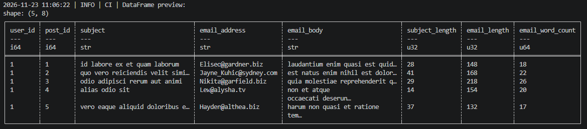
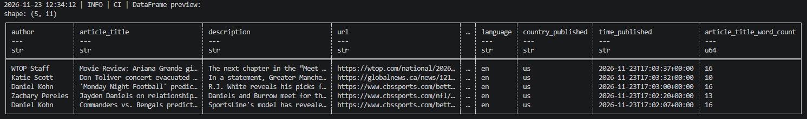
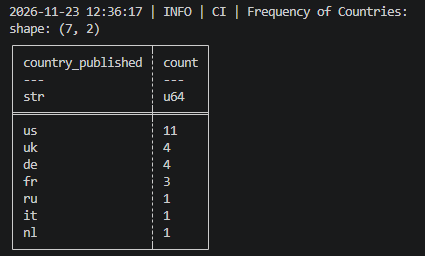
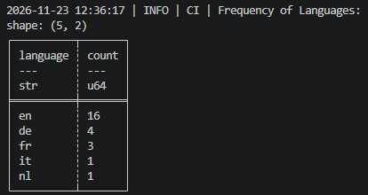

# Phase 4

## Modification

In phase 4, we are expected to make a technical modification. For this modification, I changed the data source and added on a word count. The data was a list of emails that contained a post id, id, name, email, and body. I was able to duplicate the steps so that a dataframe was created with all of the data. In the example project, the title length and body length were calculated. I calculated those but then also calculated the number of words in the email.

## DataFrame Preview

## Analysis

Adding on a word count is an easier to understand indicator of how long an email is. Rarely do we consider how short or long a word is when analyzing text, we typically care more about word count. Additionally, letters individually don't carry specific meaning, but words do. So it would be better worth our time to focus on words and the analysis of words instead of letters.

## Links to files for Phase 4

- [pipeline_api_json.py](../src/nlp/pipeline_api_json.py)
- [config_phase4.py](../src/nlp/config_phase4.py)
- [stage01_extract.py](../src/nlp/stage01_extract.py)
- [stage02_validate.py](../src/nlp/stage02_validate.py)
- [stage03_transform_p4.py](../src/nlp/stage03_transform_p4.py)
- [stage04_load.py](../src/nlp/stage04_load.py)

I did not create a new pipeline_api_json.py file for each phase. I just edited the files it imported from.

# Phase 5

## The Data

For phase 5, I wanted to change the data source, so that it's set up was different from the previous activities. I went online and through API layer found Mediastack, that aggregates news articles from sources worldwide.

https://app.apilayer.com/api-details/mediastack

I had to use AI a bit to be able to access the data. I wasn't able to copy and paste from the website using the directions it gave me, but it all got worked out. I did have to make sure the environment variable was set but running the code in the same window as the pipeline: $env:MEDIASTACK_KEY="your-key-here"

Once I got the data pull all set up in the config file, I didn't have to do any editing to the stage01_extract file.

## Validating and Transforming

In stage02_validate I had to add a line of code to the file. The data I chose was stored as a dictionary, but the code was expecting it to be a list, so the code I added made it so that it grabbed the list in my dataset.

In stage03_transform I updated the records so that they matched the structure of the data and followed standard practice in column naming conventions. After turning the data into a dataframe, I also created frequency tables for news categories, countries where the news article was published, and languages the articles were published it.

I did not edit stage04_load for any part of the project.

Data Frame Preview

News Article Category Frequency Table

Country of Origin Frequency Table

Language of Article Frequency Table

## Analysis

Most articles fell into the "general" category(16), which sports (5) being the next highest category. Most articles are published in the United States (11), followed by the United Kingdom (4) and Denmark (4). Most articles were published in English (16). In this dataset, most articles are general articles written in English and produced in the United States. It would be interesting to see what the parameters were determine which category news articles went into. For instance, the first two articles in the dataframe preview are about movies and concerts, which I would think would land them both in the entertainment category but they can't both be because in the frequency table there is only one news article counted as entertainment.

## Links to files for Phase 5

- [pipeline_api_json.py](../src/nlp/pipeline_api_json.py)
- [config_news.py](../src/nlp/config_news.py)
- [stage01_extract.py](../src/nlp/stage01_extract.py)
- [stage02_validate_news.py](../src/nlp/stage02_validate_news.py)
- [stage03_transform_news.py](../src/nlp/stage03_transform_news.py)
- [stage04_load.py](../src/nlp/stage04_load.py)

## Summary

This project was able to be adapted to two different data sources. In phase 4 the data structure was similar so it only required a few minor edits in order to make the pipeline word for the new data type. The data used in phase 5 required some troubleshooting but the pipeline was still able to work. More tables were created in phase 5 to help analyze the data as well.
